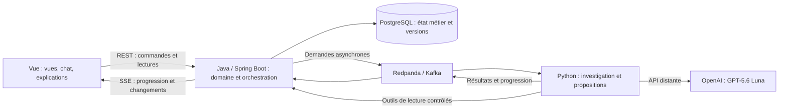

# Stack inspectée et adaptations proposées

## Sources locales consultées

Projet de référence : `/home/kek/projects/ambitious-poc`.

- `webapi/pom.xml`, `bff/pom.xml` ;
- `frontend/package.json` ;
- `docker-compose.yml`, `.devcontainer/Dockerfile` ;
- `rag-sidecar/requirements.txt`, `rag-sidecar/main.py` ;
- `webapi/src/main/java/com/ambitious/webapi/smartaction/event/SmartActionExecutionEventPublisher.java` ;
- `bff/src/main/java/com/ambitious/bff/bg/SaeEventListener.java` ;
- `bff/src/main/java/com/ambitious/bff/bg/BgTaskEmitterRegistry.java`.

Les versions ci-dessous sont **déclarées dans le projet de référence**, pas certifiées comme versions cibles actuelles. Les plages npm ne prouvent pas une version effectivement installée.

## Constats vérifiés

| Élément | Déclaration observée | Conséquence pour le nouveau POC |
|---|---|---|
| Java / Spring Boot | Java `25`, Spring Boot `4.0.6` dans les deux POM | Base de comparaison ; vérifier les versions stables et compatibles avant gel. |
| Accès aux données | Spring Data JPA, PostgreSQL, Liquibase | Candidats cohérents avec la stack demandée, à confirmer. |
| IA du backend | Spring AI `2.0.0-M5`, OpenAI et Google GenAI | Les agents constatés sont côté Java ; ne pas prétendre reprendre un système agentique Python déjà présent. |
| Vue | `3.5.33` | Conserver Vue selon l'exigence, actualiser la version ensuite. |
| Frontend | Vue Router `^4.5.0`, Pinia `^2.2.6`, Tailwind `^4.2.4`, Vite `^7.3.2`, TypeScript `~5.6.3`, Vitest `^2.1.8` | Inspiration, pas obligation de reprendre chaque dépendance. |
| Python | Sidecar FastAPI `0.136.1`, Uvicorn `0.34.3`, Pydantic `2.11.5` | Ce sidecar sert au parsing/chunking RAG et n'est pas le service agentique cible. |
| PostgreSQL | Image `pgvector/pgvector:pg18` | Recommander PostgreSQL standard sans extension vectorielle pour ce POC sans RAG. |
| Redpanda et Console | Images taguées `latest` | Conserver Redpanda, mais fixer des versions explicites pour la reproductibilité. Console facultative. |
| Exécution de référence | Compose déclare PostgreSQL, Valkey, Redpanda, Console et sidecar RAG | Ce fichier ne fournit pas à lui seul toute l'application conteneurisée demandée pour le nouveau POC. |
| DevContainer | Temurin 25, Node.js 22, Python installé par apt | Ne remplace pas un Compose applicatif complet ; version Python non fixée explicitement ici. |

## Chemin événementiel réellement observé

`SmartActionExecutionEventPublisher.publish` envoie un événement dans le topic `smart-action-execution-events`, avec `userId` comme clé Kafka.

`SaeEventListener.onSaeEvent` consomme ce topic puis republie le JSON sur un canal Valkey `bg:events:{userId}`.

`BgTaskEmitterRegistry.onMessage` transmet le message au `SseEmitter` enregistré pour cet utilisateur. Sans connexion active, le message est abandonné ; `register` reçoit un état initial des tâches en cours. L'enregistrement remplace l'ancien emitter du même utilisateur.

Ce chemin est une inspiration pour la progression visible, **pas un contrat de reprise ou de livraison à recopier tel quel**. Le nouveau POC doit notamment permettre plusieurs vues/onglets et retrouver l'état durable après reconnexion.

## Proposition d'adaptation — à valider

- Un backend métier Java modulaire ; pas de BFF séparé par défaut.
- Python propose, Java contrôle les transitions et la publication des règles.
- Kafka pour le travail agentique durable ; REST pour les commandes courtes et les lectures ; SSE pour informer le navigateur.
- Aucune dépendance RAG, pgvector, Keycloak ou Valkey.
- Répartition exacte des données, persistance agentique et mécanisme de reprise à décider.

## Modèle OpenAI vérifié documentairement

La documentation officielle consultée identifie le modèle demandé par `gpt-5.6-luna` et annonce le support de `function_calling`, `structured_outputs` et du streaming.[1]

L'accès avec la future clé de Kevin, la qualité du modèle sur nos scénarios et les budgets ne sont pas encore testés. Aucun appel payant n'a été effectué. Ne pas remplacer ce modèle par un autre sans arbitrage.

La clé sera uniquement dans le `.env` local ignoré par Git ; le frontend ne doit jamais la recevoir. Prévoir un `.env.example` sans secret et ne pas embarquer `.env` dans les images ou exports de démonstration.

## Vérifications avant gel technique

- Versions stables maintenues, compatibilité Java/Spring et Python/SDK/framework.
- Licence de chaque composant et image ; distinguer open source, source available et gratuité d'usage personnel, particulièrement pour les distributions Redpanda et l'outillage Docker choisi.
- Runtime local complet sans compte fournisseur supplémentaire, hors OpenAI demandé.
- Limites de ressources de la machine et durée acceptable d'une investigation.
- Images et dépendances fixées, lockfiles, healthchecks et démarrage reproductible.
- Exposition réseau locale seulement en l'absence d'authentification applicative.
- Stratégie de suppression/recréation des seuls volumes du POC, sans toucher aux autres projets.

## Sources

[1] https://developers.openai.com/api/docs/models/gpt-5.6-luna — GPT-5.6 Luna — documentation API OpenAI
