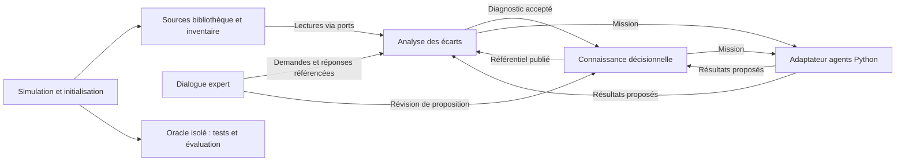
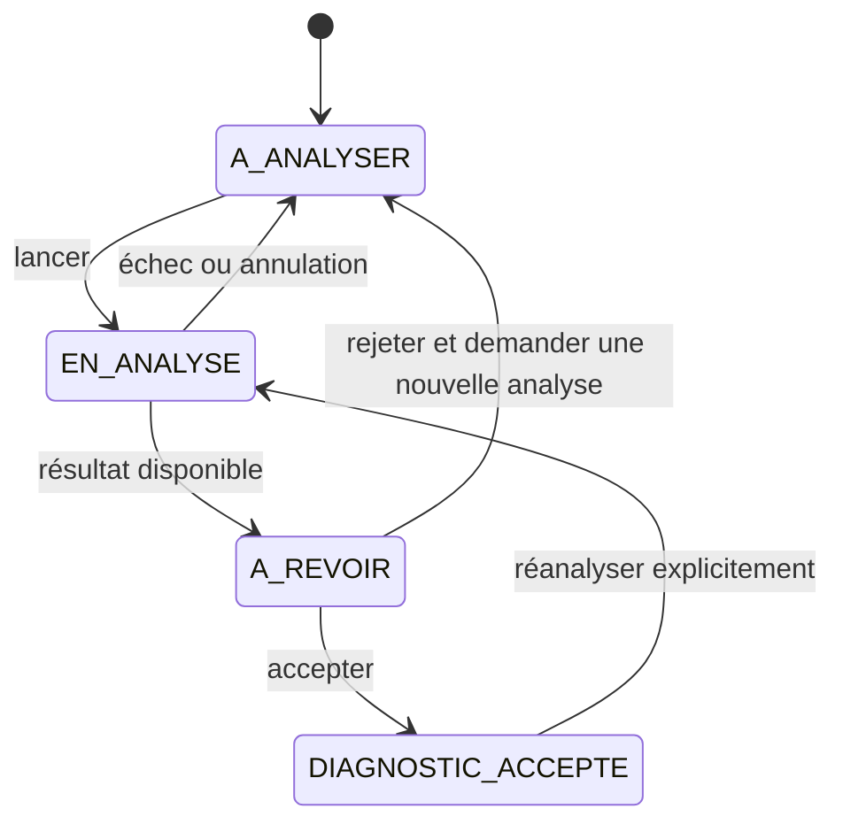
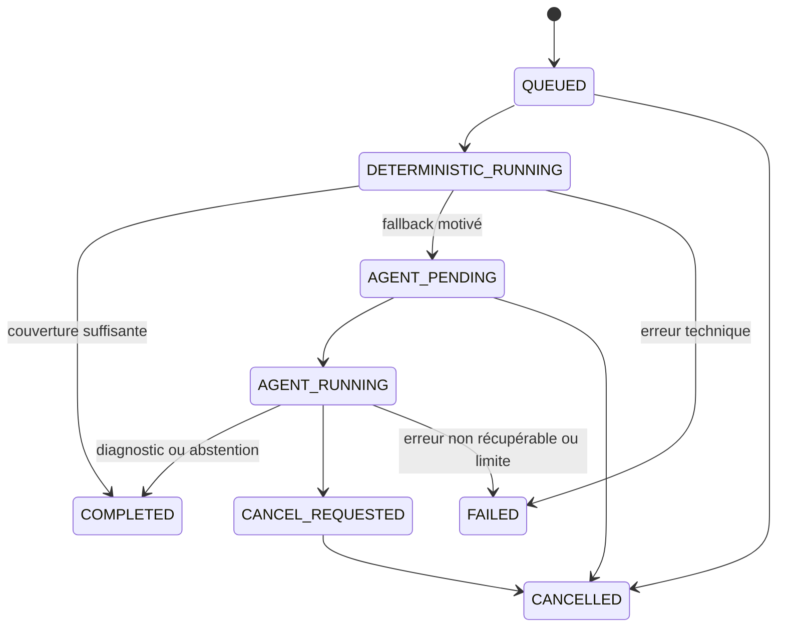
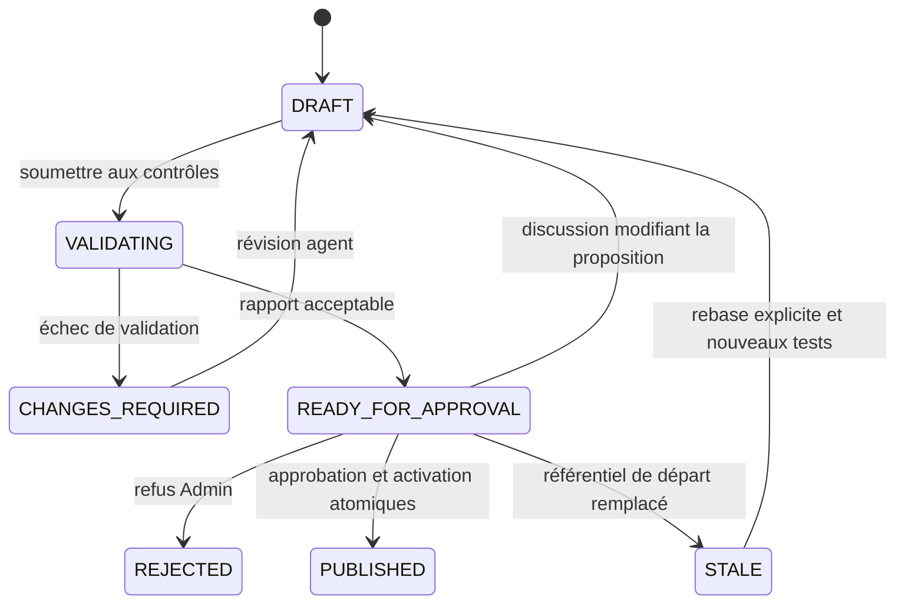

# Domaine DDD, agrégats et cycles de vie

## Statut

Répartition Java/Python/Vue validée ; conception détaillée ci-dessous **PROPOSÉE pour la revue finale**. DDD sert ici à protéger des invariants, pas à multiplier les services ou les interfaces.

## Vocabulaire explicite validé — 2026-10-31

Ces termes sont utilisés dans les discussions et les livrables du projet. Les identifiants techniques existants restent inchangés ; ils sont accompagnés de leur sens métier lorsqu'ils sont présentés.

Trois niveaux distincts : **bibliothèque simulée** (actions et données métier), **application d'analyse** (dossiers et preuves), **moyens de diagnostic** (règles DMN/FEEL et agents LLM). Les prêts, retours et pannes de mise à jour sont représentés dans les données fictives ; notre application les analyse, sans effectuer ces actions ni corriger le stock.

| Terme à utiliser | Définition | Ancien terme ou identifiant technique |
|---|---|---|
| Opération métier | Action concernant un exemplaire : prêt, retour, déplacement ou réparation ; son enregistrement fournit une trace consultable | « Opération » seul est évité ; ce n'est ni un appel d'outil ni un changement de règle |
| Mise à jour du stock informatique | Traitement qui répercute une opération métier dans l'état informatique de l'exemplaire ; il peut réussir, échouer ou rester en attente | « Intégration » dans les données de bibliothèque ; `IntegrationProcessed` |
| État du stock informatique | Situation et emplacement indiqués par le système de bibliothèque | « Projection de stock », `systemState` |
| Observation d'inventaire | Scan ou constat physique daté, avec lieu et qualité ; ce n'est pas une vérité garantie | `observations` |
| Dossier d'écart | Dossier d'un exemplaire dont les données informatiques et les observations présentent une divergence à analyser | « Cas », `caseId` |
| Dossier de preuves figé | Copie des données disponibles pour une analyse d'un dossier : état informatique, observations, événements, notes et disponibilité des sources | « Snapshot de preuves », `EvidenceSnapshot`, `snapshotId`, `get_case_snapshot` |
| Version figée des règles | Publication et versions de règles conservées comme référence de l'analyse | « Snapshot de référentiel » ; distinct du dossier de preuves |
| État de synchronisation de l'interface | Ensemble des états applicatifs et curseur utilisés pour ouvrir ou reprendre le flux de notifications | `SyncSnapshot`, `/api/sync-snapshot` ; distinct d'un dossier de preuves |
| Fait utilisable par une règle | Valeur structurée extraite des preuves sans LLM, avec type et provenance ; pas une cause déjà décidée | Entrée de DMN/FEEL |
| Diagnostic | Conclusion expliquée à partir des preuves, avec limites et recommandations | Distinct d'un fait et d'une correction du stock |

Exemple : un retour est enregistré, sa mise à jour du stock informatique échoue, l'exemplaire est observé au comptoir mais reste indiqué comme prêté. L'analyse fige ces preuves, puis recherche une explication. Le dossier de preuves figé n'est ni une sauvegarde de toute la base, ni un diagnostic, ni une garantie de vérité ou de complétude.

Un « test entre composants » désigne une vérification de l'assemblage logiciel ; un échange Kafka désigne le transport d'une mission ou d'un résultat. Ni l'un ni l'autre n'est une mise à jour du stock informatique de la bibliothèque simulée.

## 1. Langage métier

- **Exemplaire** : objet physique identifiable, distinct d'une notice bibliographique.
- **Situation informatique** : état/localisation supposés par le système source.
- **Observation d'inventaire** : scan ou constat, avec provenance, lieu et date ; ce n'est pas automatiquement la vérité absolue.
- **Écart** : divergence documentée entre attendu et observé dans un périmètre couvert.
- **Cas** : dossier d'analyse d'un exemplaire pour une campagne. Plusieurs symptômes peuvent appartenir au même cas.
- **Analyse** : exécution bornée sur des données et un référentiel de règles figés.
- **Diagnostic** : conclusion étayée, partielle ou indéterminée ; peut contenir plusieurs hypothèses distinctes.
- **Règle** : connaissance décisionnelle avec identité stable ; sa version contient la logique DMN/FEEL.
- **Proposition de changement** : ensemble cohérent de créations, révisions et retraits proposé par l'agent de règles.
- **Publication** : version immuable du référentiel actif produite par l'approbation d'un changement.
- **Retrait** : fin d'applicabilité pour les nouvelles analyses, sans destruction de l'historique.

Ne pas appeler « résolu » un stock corrigé : le POC ne corrige pas le stock. Un cas peut être **diagnostic accepté**, tandis que l'écart physique/informatique existe toujours.

## 2. Contextes logiques proposés

- `librarysource` : modèles de lecture des sources simulées, sans CRUD métier de prêts/réceptions dans l'UI.
- `analysis` : cas, analyses, preuves, conclusions et acceptation.
- `knowledge` : règles, propositions, validations, publications et retraits.
- `dialogue` : conversations structurées et séquençage des tours.
- `simulation` : seed, génération, chargement et oracle ; chemins de diagnostic sans accès à l'oracle.
- `execution` : missions techniques, quotas, outbox/inbox et progression ; ne remplace pas les états métier.

Déploiement : ces contextes résident dans le même backend Spring Boot, organisés en packages. Pas de microservice par contexte.

## 3. Agrégats et invariants

| Racine | Contenu et références | Invariants principaux |
|---|---|---|
| `GapCase` | Identité exemplaire/campagne, symptômes, liens vers analyses, diagnostic accepté courant | Unicité du cas par campagne/exemplaire ; pas d'écrasement des analyses passées ; une seule analyse métier active par cas dans le POC |
| `AnalysisRun` | Dossier de preuves figé, version du référentiel, étapes, conclusions, mission associée | Référentiel et données figés ; une transition terminale n'est pas réouverte par un résultat tardif ; annulation ≠ diagnostic négatif |
| `Rule` | Identité stable, versions immuables, provenance diagnostic et proposition | Pas de modification en place d'une version publiée ; pas de création/révision manuelle par l'Admin |
| `RuleChangeProposal` | Base du référentiel, révision du brouillon, opérations CREATE/REVISE/RETIRE, tests et approbation | Création ancrée dans un diagnostic accepté ; révision liée à une règle et à ses cas d'origine ; toute modification invalide les validations dépendantes |
| `RuleSetPublication` | Version, manifeste ruleId/versionId, rapport de validation, approbation | Une publication est complète et immuable ; le pointeur actif change atomiquement ; aucun retrait ne supprime l'historique |
| `ExpertConversation` | Contexte cas/règle/proposition, messages, références et tours | Un seul tour actif par conversation ; réponses attachées à une révision précise ; aucun message ne vaut approbation |
| `AnalysisBatch` | Liste figée de cas sélectionnés et états enfants | Taille bornée ; chaque cas garde son résultat ; annuler un lot ne supprime pas ses résultats terminés |

Les collections volumineuses de preuves/messages sont persistées séparément et référencées ; un agrégat n'implique pas de charger tout l'historique en mémoire.

### Retrait demandé directement par l'Admin

Le droit de retrait est acquis. Proposition : il passe par une commande dédiée avec aperçu d'impact et confirmation, puis publication atomique d'un référentiel sans la règle. Il ne nécessite pas qu'un agent réécrive la règle. Les propositions en attente basées sur l'ancienne publication deviennent périmées.

## 4. Cycles de vie

### Cas métier

Une réanalyse conserve le diagnostic accepté précédent comme historique. Un diagnostic indéterminé peut être accepté comme constat d'insuffisance, sans produire de règle de cause.

### Analyse

Toute étape non terminale supporte une annulation selon son point sûr ; le diagramme montre les transitions principales. Le dépassement d'une limite conserve les preuves déjà collectées, mais ne crée pas une conclusion complète fictive.

### Proposition et publication

L'approbation et la mise à jour du pointeur actif doivent être dans la même transaction finale ou liées par un protocole empêchant toute publication d'une révision non approuvée. Aucun état approuvé réutilisable après modification.

### Versions de règles

Une version est `DRAFT` tant qu'elle appartient à une proposition ; après publication elle est immuable. Son applicabilité est déterminée par le manifeste de la publication, pas par un booléen mutable réécrivant son histoire. « Active », « remplacée » et « retirée » décrivent son applicabilité dans le référentiel courant.

## 5. Modèle de données logique proposé

| Groupe | Entités/table candidates |
|---|---|
| Sources | `bibliographic_record`, `copy`, `site`, `location`, `system_copy_snapshot`, `loan_event`, `return_event`, `receipt_event`, `transfer_event`, `maintenance_event`, `integration_event`, `operator_note` |
| Inventaire | `inventory_campaign`, `inventory_scope`, `scan_session`, `inventory_observation` |
| Analyse | `gap_case`, `gap_symptom`, `analysis_run`, `evidence_snapshot`, `evidence_reference`, `diagnostic_revision`, `diagnostic_acceptance` |
| Connaissance | `rule`, `rule_version`, `rule_change_proposal`, `proposal_operation`, `validation_report`, `rule_set_publication`, `rule_set_member`, `active_rule_set` |
| Dialogue/exécution | `expert_conversation`, `chat_message`, `agent_mission`, `mission_attempt`, `analysis_batch`, `batch_item`, `outbox_event`, `inbox_event`, `progress_event` |
| Simulation | Manifestes de génération et oracle dans un espace non accessible au rôle SQL de l'application |

Colonnes communes selon besoin : identifiant, version de verrouillage optimiste, `datasetEpoch`, dates UTC, provenance. Les temps métier simulés sont distincts des temps réels d'exécution.

Stocker les DMN originaux, leur empreinte, la version du moteur, le schéma des faits et les prompts/configurations utilisés. Le hash lie un rapport à son artefact ; il ne constitue pas une certification réglementaire.

## 6. Anti-corruption et dépendances

- Le domaine Java ne dépend ni d'un client OpenAI ni de types Kafka ou JPA.
- Les cas d'usage applicatifs coordonnent agrégats, transactions et ports.
- L'adaptateur DMN traduit les types métier vers les contextes du moteur et traduit ses sorties en résultats contrôlés.
- Les résultats Python sont des propositions non fiables jusqu'à validation de schéma, références, état et droits par Java.
- Le frontend ne recalcule ni diagnostics, ni conflits, ni statuts de publication.
- Les données de test ne sont pas exposées comme preuve métier ; les annotations pédagogiques sont dans un canal séparé.

## 7. Décisions encore à finaliser

Sémantique de combinaison des règles et couverture multi-symptômes ; bornes des lots et quotas ; granularité des dossiers de preuves figés ; sous-ensemble DMN/FEEL ; détails UX de retrait et de diagnostic indéterminé. Les noms de classes/tables sont des contrats de conception proposés, pas du code déjà livré.
