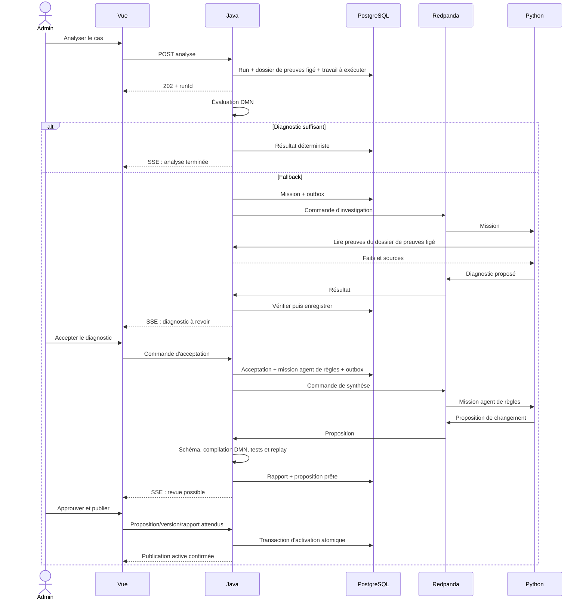

# Architecture locale et contrats d'échange

## Autorité actuelle — 2026-10-31

La stack et les frontières Java/Python/Vue sont conservées selon [la vision actuelle](00-vision-et-exigences.md). Les mécanismes détaillés ci-dessous restent des propositions historiques, pas une liste de fonctionnalités livrées : voir [l'audit](12-etat-implementation-actuel.md).

La cible privilégie dix dossiers, deux acquisitions indépendantes, outils successifs et chat réel. Les conditions FEEL sont produites par le LLM puis sérialisées en DMN standard par Java. L'adoption du SDK Agents n'est pas reconfirmée ; la Responses API actuelle constitue l'existant, pas une connexion automatiquement interchangeable.

Les contrats seront réconciliés avec le code au jalon correspondant de [la roadmap](13-roadmap-demo.md), notamment tours expert, révisions, traces, missions et publication liée au rapport. Pas de nouveaux services par principe, de budgets historiques imposés ni de suppression de volumes comme unique solution de reset.

## Architecture détaillée historique

## Statut

**Validé** : Vue REST/SSE ; Java/Spring Boot propriétaire du domaine, des cycles de vie et de DMN ; deux rôles IA dans un service Python ; Kafka sur Redpanda ; exécution locale Docker Compose ; pas de RAG, Keycloak, Valkey, architecture multi-instance ou correction de stock.

Les mécanismes détaillés et noms de contrats sont proposés pour validation finale.

## 1. Conteneurs et responsabilités

| Service | Responsabilité | Données persistées / exposition |
|---|---|---|
| `frontend` | Assets Vue et reverse proxy vers Java | Port hôte lié à localhost ; aucun secret OpenAI |
| `backend` | REST, SSE, domaine, moteur DMN, validation/publication, orchestration | PostgreSQL ; accès via proxy ; aucune dépendance OpenAI directe |
| `agents` | Worker Kafka, investigateur et agent de règles, outils REST contrôlés | Pas de base métier propriétaire ; historique récupéré via Java ; clé OpenAI injectée seulement ici |
| `postgres` | Sources simulées, analyses, conversations, règles, publications, outbox/inbox | Volume nommé du POC ; pas d'exposition hôte par défaut |
| `redpanda` | Transport asynchrone des missions/résultats | Un nœud local, volume nommé ; aucune fonctionnalité Enterprise requise |
| `redpanda-console` | Inspection technique optionnelle | Profil Compose `tools`, localhost |
| `seed` | Initialisation/recréation déterministe | Job à usage ponctuel ; droits dédiés pour charger les sources et l'oracle |

L'oracle est dans un schéma/stockage séparé dont le rôle SQL de l'application ne possède pas les droits. Il n'est pas monté dans le worker Python. Les scripts d'évaluation seuls y ont accès.

## 2. Choisir sync/async selon la responsabilité

| Interaction | Mode proposé | Raison |
|---|---|---|
| Lire liste, cas, règles, historique | REST synchrone | Résultat court et paginé |
| Demander une analyse, envoyer un message, lancer des tests | REST → accusé `202` avec identifiant | L'acceptation d'une commande n'est pas sa réalisation |
| Accepter un diagnostic | REST transactionnel | Décision métier courte, verrouillage optimiste |
| Approuver/publier un changement préparé | REST transactionnel après préparation | Réponse contient la publication active ou un conflit explicite |
| Lancer une mission Python | Kafka | Découpler l'exécution longue de la requête navigateur |
| Interroger les preuves pendant une mission | REST Python → Java | Outils de lecture ciblés sur dossier de preuves figé ; pas d'accès SQL libre |
| Retourner proposition/résultat Python | Kafka | Validation et adoption par Java ; résultats corrélés et dédupliqués |
| Informer Vue | SSE Java → navigateur | Progression unidirectionnelle, historique durable accessible par REST |

L'Admin n'attend pas une requête HTTP ouverte pendant plusieurs minutes. Aucun événement Kafka n'est consommé directement par le navigateur.

## 3. Séquence nominale

Le lancement automatique de la synthèse après acceptation est une proposition UX : l'Admin peut annuler la mission. Le modèle n'est pas maintenu en attente pendant la réflexion humaine ; une nouvelle mission reçoit le contexte persisté.

## 4. Contrats de missions

Topics candidats :
- `stock-gap.agent.commands.v1` ;
- `stock-gap.agent.events.v1` ;
- `stock-gap.agent.dead-letter.v1` pour erreurs non récupérables inspectables.

Clé Kafka : `missionId` pour l'ordre d'une mission. Le séquençage des conversations et des cas est garanti par Java ; ne pas supposer qu'un ordre global résulte de plusieurs partitions.

Enveloppe commune : `eventId`, `eventType`, `schemaVersion`, `occurredAt`, `datasetEpoch`, `correlationId`, `causationId`, `caseId?`, `analysisId?`, `missionId`, `attempt`, `conversationId?`, `turnId?`, `proposalId?`, `proposalRevision?`, `ruleSetVersion`, `evidenceSnapshotId`, `sequence`, `payload`.

Les champs optionnels dépendent du type d'événement ; le schéma de chaque type les rend explicitement obligatoires ou interdits. La commande précise le rôle, le contexte autorisé, les limites et la version de prompt.

Types candidats : `InvestigationRequested`, `RuleSynthesisRequested`, `RuleRevisionRequested`, `ExpertTurnRequested`, `CancellationRequested`, `MissionStarted`, `ToolObservationRecorded`, `TextChunkProduced`, `DiagnosticProposed`, `RuleChangeProposed`, `MissionFailed`, `MissionCancelled`.

Les chunks de texte sont regroupés pour ne pas transformer chaque token en événement durable. Les conclusions et propositions structurées restent des messages complets validables.

## 5. Transactions, doublons et reprise

- **Outbox Java** : état métier et événement à publier sont écrits dans la même transaction. Un dispatcher publie puis marque l'envoi ; un doublon est possible et attendu.
- **Inbox Java** : un résultat n'est adopté qu'une fois par `eventId` et transition/mission attendue. La réception est commitée avec son effet métier avant l'ack de consommation.
- **Prise de mission** : avant un appel LLM, Python réclame une tentative auprès de Java ; un doublon déjà terminé est ignoré, une tentative en cours n'est pas redémarrée en parallèle.
- **Reprise** : lease/heartbeat bornés et numéro de tentative. Une tentative perdue peut être relancée sous quota ; un résultat d'une ancienne tentative est historisé comme tardif, pas appliqué.
- **Limite honnête** : l'effet métier peut être idempotent, mais un crash après un appel OpenAI et avant sa persistance peut conduire à répéter un appel. Ne pas promettre une facturation ou inférence « exactly once ».
- **Annulation** : marqueur métier consultable avant les outils et appels suivants ; arrêt best effort de l'appel réseau en cours. Après adoption de l'annulation, un résultat tardif ne publie rien.
- **Reset** : nouvel `datasetEpoch` et remise à zéro des topics/volumes du POC empêchent d'adopter des résultats d'un ancien jeu.

Les outils REST internes sont limités à la mission et au dossier de preuves figé déclarés. Une identité technique interne simple peut être configurée sans introduire de persona utilisateur ou de fournisseur d'identité. Pas d'accès du worker aux opérations d'approbation/publication.

## 6. REST proposé

Lectures : `/api/cases`, `/api/cases/{id}`, `/api/analyses/{id}`, `/api/rules`, `/api/rules/{id}/versions`, `/api/proposals/{id}`, `/api/publications`, `/api/conversations/{id}/messages`.

Commandes : lancer analyse/lot, annuler, accepter/rejeter diagnostic, envoyer message, tester proposition, approuver-publier, retirer règle. Chaque commande porte un identifiant d'idempotence et les versions attendues si elle modifie un état existant.

`409` : état ou version périmés ; `422` : commande/proposition invalide ; `429` : limite technique ; `503` : dépendance indisponible. Un `202` ne doit jamais être affiché comme « diagnostic terminé ».

Outils internes Python : consulter un dossier de preuves, lire chronologie/prêts/retours/transferts/notes, consulter règles et publications, demander une prévalidation bornée d'un brouillon. Interdits : SQL libre, shell, écriture de stock, activation de règle, lecture de secrets ou oracle.

## 7. SSE et état durable

Flux proposé `/api/events`, avec identifiant d'événement et types documentés. Les événements sont des notifications d'un changement déjà accepté par Java.

À l'ouverture/reconnexion, Vue relit l'état courant par REST puis reprend le flux à partir du curseur convenu. Si l'historique du curseur n'est plus disponible, le serveur demande une resynchronisation complète ; il ne feint pas d'avoir rejoué tous les messages.

Plusieurs onglets peuvent écouter sans se déconnecter mutuellement. Heartbeats, nettoyage des connexions et bornes de rétention sont explicites. La fermeture du navigateur n'annule pas une mission.

## 8. DMN au runtime

**VALIDÉ :** moteur DMN Apache KIE embarqué via dépendances Java, sans plateforme Kogito/Camunda séparée. Python utilise OpenAI Agents SDK, sans LangGraph/Temporal. Les versions proposées sont documentées dans la stack ; leur compatibilité intégrée devra être testée.

Chaque candidat est parsé, validé et compilé avant activation ; les imports non autorisés, extensions Java, appels externes et fonctions non déterministes sont refusés. La validation FEEL doit analyser une structure syntaxique, pas se limiter à une recherche textuelle de mots interdits.

Les runtimes préparés sont indexés par publication. PostgreSQL reste la vérité du pointeur actif ; les caches mémoire locaux sont jetables. Après redémarrage, reconstruire la publication active et les versions nécessaires aux analyses en reprise ; si la reconstruction échoue, bloquer l'analyse avec une erreur explicite.

Ne pas réintroduire Valkey : un cache mémoire d'artefacts compilés dans une seule JVM ne justifie pas un cache distribué.
