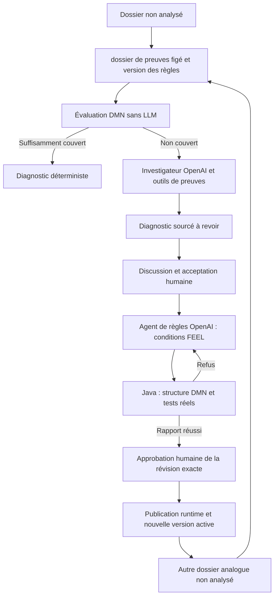

# Guide pédagogique — comprendre la boucle hybride

## Public, lecture et statut

Pour développeurs et architectes découvrant agents LLM et DMN. Ce guide explique les traitements et les technologies du projet ; il distingue **EXISTANT** et **CIBLE**, sans présenter une spécification comme une exécution réussie.

Commencer par [la vision](00-vision-et-exigences.md), puis [le scénario 2 + 4 + 4](09-donnees-evaluation-et-reset.md). Pour les preuves de livraison actuelles, lire [l'audit](12-etat-implementation-actuel.md) ; pour les travaux restants, [la roadmap](13-roadmap-demo.md).

## Premier traitement livré : préparer les dix dossiers

1. Le générateur Java 2.0.0 crée dix exemplaires et leur historique court : réception/rangement, puis les seules opérations utiles aux trois causes. Les deux dossiers de localisation ont un constat fiable ailleurs ; les retours/réparations possèdent une mise à jour échouée corrélée à leur opération métier.
2. L'export public contient les preuves, jamais les causes attendues. Son manifeste public contient volumes, version, seed et SHA-256 ; les attentes et exemples difficiles restent dans les fichiers privés de test.
3. Le backend vérifie le manifeste, importe dans une nouvelle époque et active R001 seule. La remise à zéro change le pointeur d'époque, pas les sources de code ni la configuration OpenAI ; les anciennes données restent isolées dans leurs époques historiques.
4. Le contrôle de préparation relit l'état actif et évalue R001 sans enregistrer d'analyse. « Deux couverts, huit hors règle » prouve la couverture de départ ; ce n'est pas huit diagnostics LLM déjà préparés.
5. Quand l'utilisateur analyse une localisation, Java persiste un vrai diagnostic DMN. Le contrôle signale ensuite que l'époque n'est plus vierge. Une remise à zéro rétablit les dix dossiers non analysés.

L'écran système affiche les neuf contrôles réels ; son état « Prête » concerne les données initiales. Il ne teste pas OpenAI et ne promet pas que Discussion Expert est livré. Voir [la recette exécutée](12-etat-implementation-actuel.md).

## 1. Ce que le système apprend

### Deuxième traitement livré : établir des faits fiables

Une liste d'événements n'est pas nécessairement chronologique. Java trie les preuves admissibles, choisit l'opération métier concernée et recherche ses tentatives de mise à jour. Si la tentative la plus récente a réussi, l'ancien échec ne doit pas devenir une cause encore active. Une mise à jour d'une autre opération ne répond pas à cette question.

Un scan unique et valide peut fournir un lieu observé. Deux lieux concurrents ou une qualité ambiguë rendent cette valeur inconnue. De même, une source partielle ne permet pas de transformer « aucun événement dans l'export » en « aucun événement n'a existé » : le compteur reste inconnu.

Le moteur reçoit ces faits sans LLM et conserve leurs références. Il vérifie les entrées indispensables avant l'évaluation : inconnu → besoin d'investigation ; conditions non satisfaites → aucun match ; hypothèse seule → investigation ; compilation cassée ou sortie non conforme → panne visible, sans agent lancé pour l'escamoter.

Les conclusions équivalentes conservent toutes leurs règles contributrices. Dans la démo mono-cause, des causes distinctes concurrentes sur le même symptôme ne sont pas départagées arbitrairement ; le système demande une investigation. Cela reste un contrôle conservateur sur le domaine de démo, pas une preuve générale de compatibilité logique.

`deterministicTrace`, accessible avec l'analyse et le dossier, contient entrées, valeurs manquantes, faits/provenance et résultats par règle, ou la phase/message d'une panne. Le replay a ensuite été livré en M3 ; l'espace de lecture détaillée des conditions FEEL reste à réaliser. Voir [M2/M3 et leurs vérifications](12-etat-implementation-actuel.md).

Le système ne modifie pas les poids du LLM. Il capitalise une connaissance sous forme de règle exécutable, conservée en base et évaluée ensuite par un moteur sans IA.

Un dossier compare une situation informatique et des observations physiques. « Écart détecté » ne signifie pas « cause établie ». Un diagnostic fournit une explication, ses preuves et ses limites ; l'expert peut l'accepter sans corriger le stock.

Une règle généralise des conditions pertinentes : elle ne mémorise pas le code-barres du dossier d'origine. Publier une règle ne réanalyse pas automatiquement tous les dossiers ; elle s'applique lorsqu'une nouvelle analyse démarre.

## 2. La boucle, pas à pas



**CIBLE :** tous ces chemins sont réels, la correction après refus est bornée. **EXISTANT :** la cascade, l'appel GPT d'investigation, la synthèse XML, les tests/replay et la publication runtime vérifiée existent ; chat, exploration progressive et synthèse FEEL sérialisée restent à réaliser.

## 3. Qui fait quoi ?

| Technologie | Rôle concret | Pourquoi elle est présente | Source |
|---|---|---|---|
| Vue, Vue Router, Pinia | Vues, navigation, état UI et notifications | Montrer faits, diagnostic, règles et dialogue sans recalculer le métier | [Frontend](../frontend/package.json), [store](../frontend/src/stores/stockGapStore.js) |
| Vite et npm | Dépendances et construction des assets | Produire l'interface servie en local ; build n'est pas recette utilisateur | [Configuration frontend](../frontend/package.json) |
| Node 22 et Nginx | Node construit Vue ; Nginx sert les assets et relaie API/SSE | Séparer build et serveur ; routes UI sur index HTML, buffering SSE désactivé, `/internal` non exposé | [Image frontend](../frontend/Dockerfile), [proxy](../frontend/nginx.conf) |
| Java / Spring Boot | API, orchestration, états métier, validations et transactions | Une autorité métier indépendante des réponses du modèle | [POM](../backend/pom.xml), [orchestration](../backend/src/main/java/com/library/stockgap/domain/service/AnalysisOrchestrationService.java) |
| Maven | Résolution, compilation et tests Java | Construire le backend et exécuter ses vérifications reproductibles | [POM](../backend/pom.xml) |
| Spring JDBC, PostgreSQL, Jackson | Persistance relationnelle et représentation JSON | Garder sources, dossiers de preuves figés, messages, versions et rapports ; lire les JSON via des types/parseurs | [Référentiel de règles](../backend/src/main/java/com/library/stockgap/infrastructure/persistence/RuleRepository.java), [POM](../backend/pom.xml) |
| Flyway | Migrations de schéma | Recréer une structure compatible au démarrage ; ce n'est pas le générateur de données | [Dépendances](../backend/pom.xml) |
| Apache KIE, DMN, FEEL | Compilation et évaluation des décisions | Exécuter des règles déclaratives versionnées sans appel LLM | [Moteur](../backend/src/main/java/com/library/stockgap/domain/service/DmnEngineService.java), [R001](../backend/src/main/resources/rules/R001-v1.dmn) |
| Python, client OpenAI, Responses API | Appels LLM et exécution des missions IA | Séparer le travail génératif des droits métier | [Worker](../agents/worker.py), [dépendances](../agents/requirements.txt) |
| Variables d'environnement et python-dotenv | Configuration locale du modèle, des endpoints et credentials | Garder les secrets hors sources/prompts/UI ; Compose injecte les valeurs au worker | [Worker](../agents/worker.py), [Compose](../docker-compose.yml) |
| Pydantic et JSON Schema | Validation des sorties structurées | Refuser champs inconnus, formats incohérents et références invalides | [Modèles Python](../agents/worker.py), [tests](../agents/test_worker.py) |
| Requests | Outils HTTP Python → Java | Lire les preuves autorisées sans connexion SQL | [Worker](../agents/worker.py) |
| Kafka / Redpanda, Spring Kafka, confluent-kafka | Transport des missions et résultats | Découpler le traitement long de la requête navigateur | [Compose](../docker-compose.yml), [dispatcher](../backend/src/main/java/com/library/stockgap/infrastructure/kafka/OutboxDispatcher.java), [worker](../agents/worker.py) |
| Redpanda Console | Inspection technique des échanges | Support pédagogique ; elle ne produit aucun diagnostic | [Compose](../docker-compose.yml) |
| REST et SSE / EventSource | Commandes/lectures et notifications serveur → navigateur | L'UI suit des états persistés ; le navigateur ne consomme pas Kafka | [API](../backend/src/main/java/com/library/stockgap/web/AdminApiController.java), [SSE](../backend/src/main/java/com/library/stockgap/domain/service/SseHubService.java) |
| Docker Engine / Compose | Exécution locale de la stack | Démarrage cohérent et séparation des services ; OpenAI reste distant | [Compose](../docker-compose.yml) |
| JUnit et unittest | Vérifications hors ligne et ciblées | Éprouver schémas/erreurs/DMN sans payer chaque test ; doubles clairement de test | [Tests Java](../backend/src/test/java/com/library/stockgap/DeterministicAnalysisServiceTest.java), [tests Python](../agents/test_worker.py) |

La stack actuelle n'utilise pas OpenAI Agents SDK, JPA ou Liquibase dans les chemins inspectés : client Responses API, JDBC et Flyway. Les outils d'orchestration cités par l'ancien framing ne sont pas automatiquement des dépendances du produit.

## 4. Simuler les sources sans simuler l'intelligence

Les événements de bibliothèque sont fictifs mais cohérents : prêt, retour, réparation et traitement de mise à jour du stock informatique. L'état du stock informatique reflète les opérations métier dont la mise à jour a été appliquée. Si une opération métier est enregistrée mais que sa mise à jour du stock informatique échoue, situation informatique et réalité physique peuvent diverger.

Le [glossaire validé](06-domaine-ddd-et-cycles-de-vie.md) distingue la bibliothèque simulée, l'application d'analyse et ses moyens de diagnostic. Un dossier de preuves figé n'est ni une copie de toute la base, ni un diagnostic, ni l'état de synchronisation de l'interface.

L'événement métier et le journal de mise à jour du stock informatique doivent être corrélés. Un échec quelconque dans l'historique ne prouve pas que le dernier retour n'a pas été répercuté : une reprise plus récente peut avoir réussi.

L'oracle décrit la perturbation introduite et les résultats admissibles pour l'évaluation. Il ne doit jamais être un outil de l'agent ou un champ de faits DMN. Les labels de démonstration restent dans le guide, pas dans les preuves fournies au modèle.

**EXISTANT :** [générateur de conception](conception/seed/README.md) et [import applicatif](../backend/src/main/java/com/library/stockgap/domain/service/DatasetSeedService.java), avec grand jeu 120 dossiers. **CIBLE :** les mêmes frontières, données ramenées aux dix dossiers et corpus technique séparé.

## 5. Dossier de preuves figé et faits : deux objets différents

Un **dossier de preuves figé** fige les preuves d'une analyse : données, références et temps de capture. Il empêche d'expliquer rétroactivement une analyse ancienne avec des sources modifiées.

Les **faits DMN** sont des entrées typées dérivées sans IA depuis ces preuves : lieux attendus/observés, qualité du scan, disponibilité d'une source, opération et résultat de mise à jour du stock informatique. Chaque valeur doit conserver sa provenance.

`false` signifie que la condition est fausse sur des données admissibles ; `unknown`/`null` signifie qu'elle ne peut pas être établie. Une source absente n'est pas une liste complète vide. Une note humaine n'est pas silencieusement transformée en fait général réutilisable.

Java normalise et corrèle les sources ; FEEL porte la décision. Une entrée `diagnosticConclusion=SUPPORTED` fabriquée avant analyse court-circuite cette distinction : c'est précisément un défaut actuel relevé par l'audit, pas un mécanisme à reproduire.

## 6. DMN, FEEL et table de décision

**DMN** représente une décision, ses entrées, sorties et tables dans un document standard. **FEEL** est le langage des expressions de cette décision. **KIE** est le moteur Java qui compile et évalue le document ; aucun LLM n'intervient pendant l'évaluation.

Dans [R001 réelle](../backend/src/main/resources/rules/R001-v1.dmn), trois colonnes booléennes testent : observation fiable, même site connu, emplacements connus différents. La ligne produit `LOCATION_DIFFERENCE` et `SUPPORTED` si les trois valent vrai.

```feel
expectedSiteId != null and observedSiteId != null and expectedSiteId = observedSiteId
```

Cette expression existe dans R001 ; elle compare des faits, pas une cause attendue. La politique `COLLECT` collecte les lignes correspondantes. `UNIQUE` exprime qu'au plus une ligne doit correspondre dans une table. Choisir une politique ne remplace pas les contrôles de conflit entre modules.

**CIBLE :** le LLM propose les expressions FEEL et les sorties, Java sérialise des éléments XML standard et leurs identités. Ce gabarit n'a pas le droit de contenir les conditions secrètes des futures règles. Une table lisible et son XML représentent la même version ; la trace d'essai restitue ce que le moteur a réellement évalué.

M3 contrôle désormais le XML et les arbres syntaxiques FEEL : faits déclarés, comparaisons/booléens simples, pas de fonctions/imports externes, une ligne et complexité structurelle bornée. L'instrumentation détaillée des conditions reste à réaliser. FEEL déclaratif ne signifie pas sandbox sûre pour tout modèle arbitraire ; les bornes de M3 ne sont pas une certification générale de temps d'exécution.

## 7. Agent LLM, outil et sortie structurée

Un rôle d'agent associe instructions, contexte, modèle et outils autorisés. Deux rôles peuvent utiliser le même fournisseur/modèle ; ils restent distincts par leur responsabilité.

Un **outil** est une fonction applicative proposée au modèle. Le modèle demande son appel ; Python vérifie les arguments et Java autorise les données effectivement retournées. L'agent ne reçoit pas un shell ou une connexion SQL parce qu'il sait écrire du texte.

La **sortie structurée** contraint la forme JSON. Elle ne prouve pas la vérité des assertions. Pydantic et Java doivent aussi vérifier que sujet, symptômes et preuves appartiennent au dossier de preuves figé, et que mission et tentative sont encore valides.

**EXISTANT :** outil dossier de preuves figé forcé, diagnostic JSON et synthèse XML. **CIBLE :** choix de consultations successives, synthèses intermédiaires factuelles, diagnostic accepté complet transmis au second rôle, proposition de conditions FEEL et retour des erreurs de tests pour correction.

Les prompts réellement utilisés sont actuellement définis dans [le worker](../agents/worker.py). Les [templates de conception](conception/agents/README.md) sont des ressources historiques, pas des preuves qu'ils sont chargés au runtime. Versionner et documenter les prompts effectifs à chaque évolution.

## 8. Discussion Expert et décisions humaines

Expliquer une preuve, contester une interprétation et affiner une règle sont trois actions distinctes. Un tour réel inclut le message, son contexte, le rôle affiché, les consultations nécessaires et une réponse persistée ; simplement stocker le message utilisateur ne réalise pas le chat.

Avant acceptation, l'investigateur répond sur le diagnostic. Après acceptation, l'agent de règles travaille sur la proposition ; l'expert peut changer de rôle. Une correction enregistrée possède une provenance humaine et déclenche une réévaluation sur demande.

Changer le diagnostic impose une nouvelle acceptation. Changer une condition impose une nouvelle révision et de nouveaux tests. L'approbation porte sur cette révision exacte : le modèle et le texte libre du chat n'ont jamais le droit d'activer le référentiel.

## 9. Compiler, tester et publier : trois preuves différentes

### Troisième traitement livré

Java relit la révision en base, puis contrôle le XML et les expressions FEEL. Il exécute le candidat sur les preuves d'origine et 33 cas de test séparés : situations attendues, reprise réussie, source inconnue, mise à jour en attente, autre opération et autres causes. Une règle limitée au code-barres/site d'origine ou ne vérifiant pas l'échec réel doit échouer sur ces variantes.

Le replay compare ensuite le référentiel avant/après sur ces cas, et le rapport affiche chaque résultat. Pour la portée retour actuelle, quatre positifs incluent le dossier d'origine ; les trente autres cas sont négatifs pour cette règle. Le corpus et les empreintes sont versionnés : ajuster une règle sur ces tests ne les transforme pas en preuve indépendante de qualité industrielle.

L'interface affiche ce rapport, pas un badge prédéfini. Au clic d'approbation, Java retrouve la proposition/révision, le rapport exact affiché et les empreintes, puis verrouille la publication active. Une version changée ou un rapport périmé est refusé ; une bonne publication est activée atomiquement et les analyses anciennes conservent leur version.

La recette PostgreSQL vérifie réellement ces écritures et la reconnaissance des trois autres retours, puis annule sa transaction. Les règles de cette recette sont des fixtures explicitement de test : aucune sortie LLM n'est inventée. Les exemples d'interface interceptés en navigateur sont également des fixtures, pas des publications du produit. Voir [les tests et limites](12-etat-implementation-actuel.md).

**Compiler** vérifie qu'un modèle peut être chargé avec une structure/types compatibles. Une table qui retourne toujours une cause peut parfaitement compiler et être métier incorrecte.

**Tester** consiste à exécuter réellement la décision sur positifs, négatifs et inconnus. Le replay compare l'ancien référentiel et le candidat sur un corpus identifié, avec détail des changements. Un succès XML ne permet pas d'afficher dix cas testés : ces chiffres doivent venir d'exécutions.

**Publier** active un manifeste immuable de versions de règles, après approbation du contenu et du rapport correspondants. Une empreinte lie des octets ; elle ne démontre ni vérité causale ni non-régression générale.

Le pointeur actif en PostgreSQL détermine la publication prise par une nouvelle analyse. Une analyse ancienne garde sa version. On modifie des données de règles au runtime, pas le code Java ; pas de Git/CI/rebuild dans le chemin critique de la démo.

## 10. Asynchronisme, doublons et progression

La requête REST demande un travail et reçoit son identifiant ; `202` signifie accepté, pas terminé. Java écrit mission et événement à envoyer ; l'**outbox** permet à un dispatcher de publier ensuite sur Kafka.

Python réclame une tentative, effectue ses appels et renvoie un résultat. L'**inbox** vise à éviter d'appliquer deux fois un événement. Son enregistrement et son effet métier doivent être cohérents : marquer `APPLIED` puis échouer avant la persistance du diagnostic n'est pas une adoption réussie.

Le **lease** est une autorisation temporaire de tentative ; le **fencing token** distingue une ancienne tentative d'une nouvelle. L'**époque** distingue deux chargements/reset du même jeu. Ces identifiants n'expliquent pas la cause du stock ; ils empêchent les résultats tardifs d'altérer le mauvais travail.

SSE notifie les changements acceptés par Java. Les états restent consultables par REST ; fermer le navigateur ne détruit pas une mission. Le replay SSE actuel est limité ; une reprise complète doit être éprouvée, pas supposée à partir du badge de connexion.

Kafka et l'idempotence métier ne garantissent pas un unique appel OpenAI facturé : un crash entre inférence et persistance peut nécessiter une répétition.

## 11. Mesures, erreurs et « open bar »

Afficher rôle, modèle réellement utilisé, nombre d'appels, outils, tokens et durée. Inclure les sorties invalides et corrections, sans exposer clés ou raisonnement interne. Une mesure fournisseur manquante doit être signalée, pas remplacée par un zéro présenté comme exact.

Pas de plafonds de consommation à fixer pour le moment. Les arrêts après corrections répétées, annulations et bornes techniques d'évaluation sont toutefois nécessaires pour empêcher une boucle infinie ou un blocage du moteur.

Une panne OpenAI, une référence inventée, un fait inconnu, un DMN invalide et une règle trop large sont des erreurs différentes. Leurs reprises doivent être expliquées et visibles ; aucune ne justifie un résultat fabriqué.

## 12. Lancer et vérifier l'existant

Le [README racine](../README.md) contient le démarrage Compose. Pour l'audit hors ligne, les tests Python remplacent OpenAI :

```bash
mvn -q -f backend/pom.xml test
cd agents
OPENAI_API_KEY=offline-audit-placeholder .venv/bin/python -m unittest -v test_worker
cd ..
npm --prefix frontend run build
```

La valeur factice de cette commande n'est jamais une clé utilisable pour la démo. Configurer le fournisseur localement sans transmettre de secret au modèle, puis convenir de la recette payante réelle. Un build ou une santé `UP` ne prouve pas que le fournisseur répond ni que Discussion Expert est livré.

Le reset doit être demandé explicitement et limité au projet. Sa cible est une nouvelle époque avec dix dossiers vierges, R001 seule, aucune ancienne trace active ; préserver la configuration locale et les autres projets. Le reset existant et les scripts historiques ne démontrent pas encore cet état cible.

## 13. Documentation à compléter à chaque livraison

Chaque traitement décrit : entrée, sortie, données consultées, rôle responsable, invariants, traces, erreurs et test qui les vérifie. Chaque technologie décrit : usage réel, configuration/version, raison de présence, limites et commande de vérification.

Maintenir les Markdown existants plutôt que créer un document par fonction. Enrichir ce guide, l'audit, les contrats de conception et le scénario avec les exemples réellement observés. Une documentation de fonctionnalité future garde le label CIBLE jusqu'au gate exécuté.

Livraison pédagogique complète : scénario guidé, dictionnaire des faits et FEEL, rôles/prompts/outils effectifs, validation/publication runtime, contrats REST/Kafka/SSE, opérations/reset, tests/mesures et limites. Une page de technologies sans explication des traitements ne suffit pas.