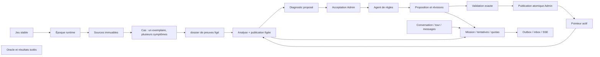

# Conception des données — POC d'écarts de stock

## Livrables et statut

Ce dossier est une **référence de réalisation**, pas une migration installée ni une application. PostgreSQL cible : **18**. Le SQL est transactionnel, sans extension, sans `DROP`, sans démarrage de service. Il est destiné à une base vide explicitement dédiée au POC ; ne pas l'appliquer à une base existante pour « voir si cela passe ».

| Fichier | Usage |
|---|---|
| `01-schema.sql` | DDL complet : sources normalisées, agrégats, exécution, transport, évaluation isolée |
| `02-roles.sql` | Habilitations de référence ; opérations administratives distinctes de la création des tables |
| `03-source-event.schema.json` | Typage discriminé des huit événements source ; conforme aux payloads de `../seed/GenerateDataset.java` |
| `04-import-et-faits.md` | Mapping de chaque tableau JSON, ordre d'import, normalisation temporelle et corrélations |
| `05-dictionnaire.md` | Chaque table/colonne, type, nullabilité, provenance, FK, contraintes et index |
| `06-relations.md` | ER Mermaid exhaustif, dérivé de toutes les FK du DDL |
| `07-transactions-et-invariants.md` | Transactions, quotas, courses, limites SQL/application, scénarios de tests entre composants |
| `verify_model.py` | Parseur SQL/PLpgSQL, revue statique des clés/types/documentation ; génération du dictionnaire/ER sur stdout |
| `test_model.py` | Tests locaux de contrat, variantes négatives, couverture du mapping et garde-fous statiques |
| `verification-results.json` | Sortie réelle de la vérification statique |
| `verification-tests.txt` | Sortie réelle des tests locaux |

Références normatives : `../00-conventions.md`, `../../06-domaine-ddd-et-cycles-de-vie.md`, `../../08-architecture-et-contrats.md`, limites de `../../09-donnees-evaluation-et-reset.md`, faits de `../../11-contrat-faits-et-dmn.md`. En cas de divergence avec une évolution future des contrats, effectuer une revue explicite ; ne pas traduire silencieusement les valeurs.

## Modèle conceptuel

1. **Jeu de données → instance → sources.** `datasetId` identifie le fichier déterministe, `datasetEpoch` une importation vivante. Une nouvelle époque n'altère ni la seed ni le temps métier. Tous les identifiants enfants sont qualifiés par époque pour permettre une réimportation des mêmes UUID sans collision ni rattachement à l'ancienne instance.
2. **Exemplaire → cas → symptômes.** Un dossier porte sur exactement un exemplaire et possède son propre `inventoryReferenceTime`. Une époque représente la campagne unique du contrat partagé ; unicité `(datasetEpoch, copyId)` des dossiers. Le modèle ne crée pas artificiellement des sessions de scan/campagnes absentes du fichier. Si plusieurs campagnes doivent cohabiter dans un même jeu à l'avenir, ajouter explicitement une identité de campagne et faire évoluer cette unicité.
3. **Sources → dossier de preuves figé → analyse → diagnostic → acceptation.** Les sources importées et symptômes sont immuables ; `gap_case` n'est que l'état de workflow associé au `source_case`. Une analyse fige un dossier de preuves figé et une publication. Les preuves sont capturées, pas relues dans un état mutable au fil de l'agent. Le diagnostic proposé, sa révision, son acceptation et une éventuelle publication de règle sont des actes différents.
4. **Règle → versions → publications.** Une identité de règle ne dit pas si elle est active. L'applicabilité vient du manifeste complet d'une publication. Une proposition possède des révisions immuables avec opérations métier et tests. Le brouillon DMN est dans l'opération ; `rule_version` est la version validée matérialisée à la publication, ce qui évite un faux état mutable `DRAFT` sur un artefact publié.
5. **Mission → tentatives → réservations.** Une mission est une limite fonctionnelle et budgétaire, une tentative un lease technique. Retry ne recrée pas le budget. Le worker Python ne possède ni tables métier ni accès SQL. Tous ses résultats sont des propositions que Java valide avant adoption.
6. **Dialogue → tours → messages.** Le seul rôle humain est **Admin**. Investigateur et agent de règles sont des rôles techniques, pas des utilisateurs supplémentaires. Un message, même « approuvé », n'appelle jamais la commande de publication.
7. **Évaluation isolée.** Attentes de simulation, perturbations injectées, familles et labels restent dans `evaluation`. Le runtime peut conserver un `causeCode` **inféré et étayé** dans le diagnostic ou la métadonnée d'une règle conformément au contrat Finding ; ce n'est jamais une cause attendue importée depuis l'oracle. Aucun `expectedCause`, `scenarioFamily` ou vérité injectée dans les faits, missions, dossiers de preuves figés ou sources runtime.

Le diagramme ER physique, y compris lots, clés composites, optionalités et tables d'évaluation, est dans `06-relations.md`.

## Modèle physique et choix assumés

- UUID natif pour les identités opaques ; code `siteId` conservé tel quel (`CENTRE|NORD|SUD`). `rule_id` utilise un domaine texte acceptant seulement `R001` ou un UUID canonique ; on ne convertit jamais `R001` en UUID et on ne dérive pas une identité de règle d'une cause cachée.
- Entiers strictement positifs pour révisions/versions ; bigint pour curseurs, séquences et verrous optimistes. PK/UNIQUE explicites ; FK composées avec époque, sauf inbox non fiable et corpus isolés, volontairement sans FK runtime.
- `timestamptz` pour les instants ; les sessions/API sérialisent en UTC avec suffixe Z. PostgreSQL ne conserve pas le fuseau textuel d'origine. `occurredAt`, `recordedAt`, capture et dates réelles d'exécution ont des sens distincts.
- JSONB seulement pour structures de preuves, résultats, enveloppes, métadonnées et payloads discriminés. Pas de JSONB pour remplacer un état de workflow, une clé, un budget ou un lien référentiel connu. Les valeurs nulles JSON ne sont pas assimilées aux absences de propriétés.
- SHA-256 fourni par le code à partir d'octets/canonicalisation **versionnée** ; SQL contrôle sa représentation, pas sa véracité. Pour DMN : octets UTF-8 exacts ; pour objets JSON/manifeste : canonicalisation déterministe documentée par l'implémentation, par exemple RFC 8785. Ne pas calculer un hash métier à partir de `jsonb::text` en supposant une norme canonique interlangage.
- Pas de montants, de lecteurs réels, de corrections de stock ou de tables de secrets. `model_configuration` exclut clés API/headers. Les explications sont des synthèses vérifiables, pas un stockage de raisonnement interne du modèle.
- Pas de partitionnement physique, de GIN universel ni d'index spéculatif : petite volumétrie du POC. Les index explicites couvrent cas actifs, historiques de sources, files, leases logiques et consommation. Mesurer `EXPLAIN (ANALYZE, BUFFERS)` dans la future base de test avant ajout d'index. Une FK ne crée pas automatiquement un index côté enfant.
- Historique conservé, aucune suppression en cascade. Seule la rétention SSE reçoit un DELETE applicatif. Le reset recrée le stockage dédié plutôt qu'un `DELETE` contournant les triggers immuables.

## Sécurité et séparation des responsabilités

`02-roles.sql` crée des rôles **NOLOGIN** de privilèges. Les identités LOGIN sont provisionnées séparément, sans mot de passe dans ce dossier ; affecter une seule famille de droits à chaque processus. Un login Java ne doit pas être membre d'un owner, d'un rôle oracle ou d'un rôle pouvant `SET ROLE` vers ceux-ci. Les droits `PUBLIC`, les memberships préexistants et privilèges de base/`public` doivent être audités lors du provisionnement. Ce script n'est pas une politique de sécurité d'un cluster partagé.

| Rôle technique | Accès prévu | Interdiction importante |
|---|---|---|
| `sg_java` | Lecture runtime ; écriture du workflow, adoption, publication | Aucun accès au schéma evaluation ; pas de mutation des sources ni TRUNCATE |
| `sg_seed_runtime` | Import sources/bootstrap, fermeture de l'import | Pas de lecture oracle ; droits retirés au service après chargement |
| `sg_seed_oracle` | Import corpus/attentes dans evaluation | Pas d'accès runtime et pas de credential transmis aux agents |
| `sg_evaluator` | Corpus et résultats d'évaluation | Pas d'accès SQL runtime ; reçoit explicitement un export d'artefacts à mesurer |
| `sg_dispatcher` | Outbox et pointeur d'époque ; colonnes de dispatch uniquement | Ne peut ni changer l'enveloppe ni publier une règle |
| Owners | Administration des objets, hors application | Jamais attribués aux workers/Java ; peuvent techniquement contourner des protections |
| Worker Python | Outils REST bornés et Kafka | Aucune connexion SQL, aucun montage oracle/générateur |

L'évaluation indépendante se fait par outillage de test avec credential dédié. Les artefacts candidats entrent par export contrôlé, les rapports techniques expurgés sont importés/vérifiés par Java avec leurs empreintes. Aucun outil agent ne peut demander le contenu de l'oracle ; les holdouts ne servent pas à ajuster une règle. Cela ne crée pas un nouvel orchestrateur applicatif.

Les droits SQL ne savent pas distinguer « requête de l'Admin » d'un « résultat de l'agent » passant tous deux par Java. La règle **CREATE/REVISE exclusivement par agent**, la validité des preuves, les transitions métier et l'absence de fuite dans le texte libre sont donc aussi des contrôles Java/API obligatoires. Le bootstrap est une exception **exactement R001 v1 / une ligne / publication v1 / un membre**, vérifiée avant ouverture de l'époque ; le DDL n'invente aucune autre règle initiale.

## Portée de la vérification

Les commandes réellement utilisées et leurs sorties sont consignées dans `verification-results.json`, `verification-tests.txt` et `08-verification.md`. Le parseur PostgreSQL/PLpgSQL valide la syntaxe, la revue statique vérifie les cibles de FK/types/clés et la présence de documentation. **Aucune base n'a été créée, aucun service démarré, aucun SQL exécuté contre un serveur**. Ce n'est donc pas une preuve d'application DDL, de droits effectifs, de plans d'exécution ou de comportement concurrent. Les essais de mise à jour du stock informatique attendus sont explicités dans `07-transactions-et-invariants.md`.
